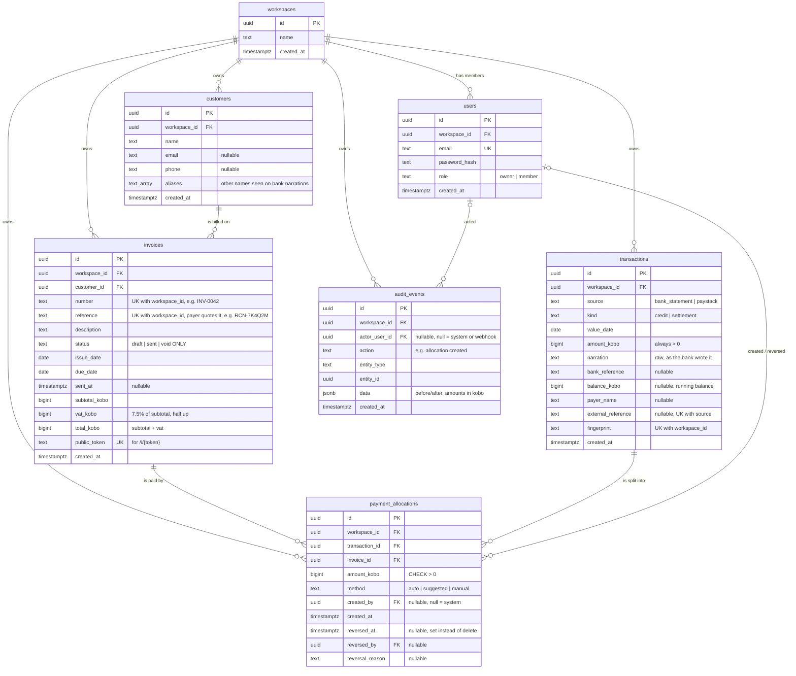

# Entity–Relationship Diagram

Source of truth for the data model. Written **before** the models; once `backend/app/*/models.py` exist,
`python backend/scripts/erd.py` prints the same diagram from the real SQLModel metadata so we can check they match.

Table names are plural (`payment_allocations`, `audit_events`) to match CLAUDE.md, and because `user` is a reserved word in PostgreSQL.

## Constraints and indexes

| Table | Constraint / index | Why (invariant) |
|-------|--------------------|-----------------|
| users | `UNIQUE (email)` | one login per email |
| invoices | `UNIQUE (workspace_id, number)` | invoice numbers restart per workspace |
| invoices | `UNIQUE (workspace_id, reference)` | exact-reference matching must find one invoice |
| invoices | `UNIQUE (public_token)` | public link must be unguessable and unique |
| invoices | `CHECK (status IN ('draft','sent','void'))` | #5 paid/part_paid/overdue are derived, never stored |
| invoices | `CHECK (subtotal_kobo > 0)`, `CHECK (vat_kobo >= 0)`, `CHECK (total_kobo = subtotal_kobo + vat_kobo)` | #1 the database refuses money that doesn't add up |
| invoices | `CHECK (due_date >= issue_date)` | an invoice can't be due before it was issued |
| transactions | `UNIQUE (workspace_id, fingerprint)` | #2 re-importing a statement adds nothing |
| transactions | `UNIQUE (source, external_reference)` | #3 duplicate Paystack webhook pays once (NULLs don't collide) |
| transactions | `CHECK (amount_kobo > 0)` | debits are not imported in the MVP |
| payment_allocations | `CHECK (amount_kobo > 0)` | no zero or negative allocations |
| payment_allocations | index `(invoice_id)`, index `(transaction_id)` | allocate() re-sums by both sides |
| audit_events | index `(workspace_id, created_at)` | audit page and dashboard activity feed |
| all tenant tables | index `(workspace_id)` | #8 every query filters by workspace |

All money columns are `BIGINT` ending in `_kobo` (#1). There is no `paid_kobo` column on invoices: amount paid is
always `SUM(amount_kobo) FROM payment_allocations WHERE invoice_id = ? AND reversed_at IS NULL`.

## Relationships explained

- **workspace → everything**: each SME is one workspace. Every tenant table carries `workspace_id` so every query can
  be scoped (#8), even tables that could reach the workspace through a join. This is deliberate duplication: a single
  `WHERE workspace_id = :ws` is easy to check in review.
- **customer → invoices**: one customer has many invoices; an invoice has exactly one customer.
- **invoices ↔ transactions (many-to-many) through payment_allocations**: one bank credit can pay several invoices
  (a customer settles two at once), and one invoice can be paid by several credits (part payments). The allocation row
  records *how much* of which credit went to which invoice. `allocate()` is the only code that inserts here (#4).
- **users → payment_allocations / audit_events**: who did it. Nullable because auto-matching and webhooks act as the system.

## Derived values (not stored)

| Value | Formula |
|-------|---------|
| invoice `paid_kobo` | sum of non-reversed allocations for the invoice |
| invoice `outstanding_kobo` | `total_kobo - paid_kobo` |
| invoice display status | checked in this order: stored `void` / `draft` → that; outstanding = 0 → `paid`; today > due_date → `overdue` (even if part paid, see DECISIONS D-05); paid > 0 → `part_paid`; else `sent` |
| transaction `unallocated_kobo` | `amount_kobo - sum of non-reversed allocations for the transaction` |
